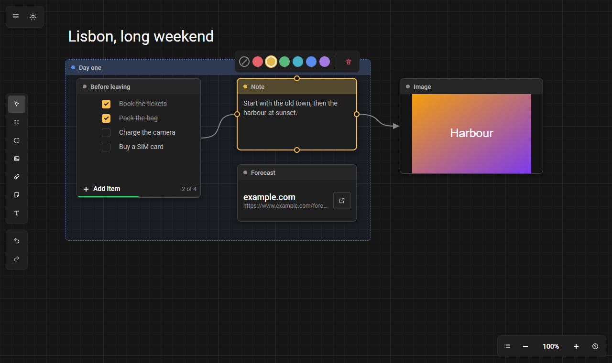
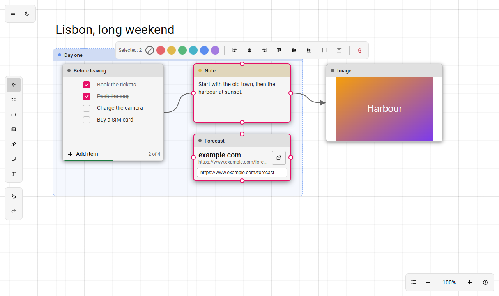

# workspace

<p align="center">
  
  
</p>

**English** · [Русский](README.ru.md)

A workspace of nodes: notes, text, checklists, links and images on an endless canvas, which you can group and connect with lines or arrows. Pins have no data types: links are purely visual. Everything runs in the browser, nothing is sent anywhere.

**Stack:** Vue 3 + TypeScript + Vite + Pinia, the interface on [TaoUI](https://www.npmjs.com/package/@1337exp/taoui), the behaviour (camera, canvas, history, commands, storage) from [TaoUX](https://www.npmjs.com/package/@1337exp/taoux). Tests: Vitest + happy-dom.

```bash
npm install
npm run dev         # the dev server
npm run build       # type check and build
npm test            # tests
npm run typecheck
npm run screenshot  # docs/media/*.png for the README, needs Chrome or Edge
```

## What it does

**Nodes.** Added with a tool in the left dock: press the tool (or its key) and click the canvas, the node lands centred on the click, `Esc` cancels. A right click on an empty place opens the palette.

| Node | Key | What it is |
|---|---|---|
| Note | `N` | a frame with a strip and text |
| Text | `T` | text right on the canvas, no frame; click and type at once; a double click edits; the height follows the content, an emptied text disappears; the colour from the bar tints the letters |
| Checklist | `L` | items with a tick: `Enter` adds an item below, `Backspace` in an empty one removes it, `↑` `↓` walk the items, an item is dragged by the handle on the left (and from the keyboard: on the handle `Space` lifts, arrows move, `Space` drops, `Esc` cancels), pasting multi-line text spreads it over items; a counter and a progress line at the bottom; "Hide completed" in the bar over the node |
| Link | `K` | a card: the host big, the address small, a button opens it in a new tab; `example.com` becomes `https://example.com`; only `http` and `https` open; we do not fetch the page (no title, no icon), so that addresses are not sent to third-party services |
| Image | `I` | an image by its link |
| Group | `G` | a frame under the rest: nodes wholly inside it travel with it when you drag it by its strip |

The title in the strip (of a note, group, checklist, link) is edited with a double click.

**Canvas.**

| Action | How |
|---|---|
| Move the camera | right or middle mouse button, the mouse wheel or a two-finger trackpad scroll; `Shift` + wheel sideways. Over a node that can be scrolled, the wheel scrolls it |
| Zoom | `Ctrl` (or `Cmd`) + wheel, a pinch on a trackpad (the point under the cursor stays put); the "−" and "+" buttons, `=` / `-`, `Shift+0` (100%), `Shift+1` (fit all) |
| Auto-scroll | while you drag a node, a frame, a link or an edge, bring the cursor to the canvas edge (48 px): the camera goes, faster the closer to the edge |
| Select | a click (the node rises above the others, groups stay underneath); `Ctrl` / `Shift` + click adds or removes; a frame: drag with the left button over an empty place |
| Move a node | by the strip with the title (an input field inside a node does not drag) or by the text itself for a Text node |
| Resize | by any edge or corner of a node (the middle of an edge is taken by a pin, take it beside) |
| Grid snapping | the "Grid" item in the view menu (on by default): a node softly sticks to grid lines (step 24) and moves freely between them; resizing and new nodes snap too. `Alt` while dragging turns it off for the moment |
| Guides | the "Guides" item in the view menu (on by default): while you drag nodes, their edges and centre are compared with the edges and centres of the other nodes; when they coincide (or are within 6 screen px) the node is pulled and a thin line runs through what coincides; a guide wins over the grid on its own axis. `Alt` turns them off for the moment too. They work while dragging; resizing snaps to the grid only |

**Links.**

| Action | How |
|---|---|
| Connect | drag from a pin (there are four: left, right, top, bottom) to another node; released over a node's body, the nearest side is taken |
| Create a node from a link | release a dragged link over an empty place |
| A point on a link | a double click on a link puts a point: drag it by its centre, drag new links from the ring around it; `Delete` dissolves the point, the neighbours connect directly |
| Link style | pick a link and switch "Line / Arrow"; "Reverse" swaps the direction; "Straighten" moves the node so that the link becomes straight |

**Panels.**

- **Left:** "Select", a tool for every node type, undo and redo.
- **Over the selection** (pinned at the bottom on touch and on a narrow screen): colour (6 colours and "no colour"; it tints the frame and the strip, the fill of a group, the letters of a text), the properties of the node type ("Hide completed" for a checklist, "Large text" for a text), alignment by edges and centres, distribution with equal gaps (three or more nodes), for a link its style, "Reverse" and "Straighten", "Delete". It acts on everything selected.
- **Bottom left:** zoom, the view menu ("Zoom to fit", 100%, grid) and the help "?" with a list of gestures and keys.
- **Top left:** the ☰ menu (file: "New", "Open" `Ctrl+O`, "Save" `Ctrl+S`; light or dark theme; language) and a quick theme switch.

**Context menu** (a right click on a node or a link; an empty place still opens the palette): "Duplicate" `Ctrl+D` (with what lies inside a group and the links between the copies; the copies get selected), "Bring to front" `]`, "Send to back" `[`, the toggles of the node type, colour, alignment (two or more nodes), "Delete"; for a link its style, "Reverse", "Straighten". A node outside the selection becomes the selection on a right click, a node inside it keeps it, and the menu acts on everything selected. A right button that was dragged pans as before.

Other keys: `Delete` removes the selection, `Ctrl+Z` / `Ctrl+Y` undo and redo, `Esc` drops the tool, then the palette, then the selection. Letter keys work on a Russian layout too.

**Touch (a tablet).** A finger moves the canvas, two fingers move and zoom, a long press on an empty place opens the palette and on a node or a link the context menu, a double tap works as a double click, the "Select" mode in the left dock stands in for `Ctrl`. A pen counts as a mouse. Details and a checklist for testing: [docs/touch.md](docs/touch.md) (in Russian). `?debug=touch` in the address shows the recognised gestures.

**Saving.** The workspace is saved automatically to `localStorage`; "Save" and "Open" work with a `workspace.json` file. The theme and grid snapping are remembered in the browser and are not written to the file.

The interface is in English and Russian, light and dark theme.

## Adding your own node

A node is split into a **definition** (code, lives in the registry) and an **instance** (data, lives in the save).
Make a folder `src/nodes/<name>/` with an `index.ts` and a Vue component: nothing else needs registering, and the tool in the left dock, the key and the help appear on their own.

```ts
// src/nodes/note/index.ts
export default defineNode({
    id: 'note',
    title: 'Note',                                   // the fallback title; translations in i18n/locales/*.ts → nodeTexts
    icon: 'node-note',                               // an icon name, see src/icons.ts
    hotkey: 'N',                                     // the key of the tool
    size: { w: 240, h: 160, minW: 120, minH: 80 },
    create: () => ({ text: '' }),                    // the data of a new node
    component: NoteNode,                             // props: data, selected; event change(patch)
});
```

The rest of the definition is optional:

- `titleKey`: the data field with the title in the strip (edited with a double click);
- `container`: a group node, lies under the rest and carries what is inside;
- `bare`: no frame and no strip (text);
- `inlineEdit` and `isEmpty`: editing in place and removing an empty node after it; the component gets `editing` and reports `edit-end` and `fit` (the height it needs);
- `actions`: toggles of the node type in the bar over the selection (`get` / `set` over the data; the label in the dictionary `nodes.<type>.action.<id>`);
- `version` and `migrate(data, from)`: node data is user content, so when the format changes, raise the version and old saves arrive on their own.

A node of an unknown type does not break loading: it is drawn as a stub and its data is saved as it is.

## How it is built

```
src/
  core/     the pure model without Vue: types, registry, workspace operations, bounds, alignment, saving and reading
  nodes/    node definitions (note, text, checklist, link, image, group, reroute)
  editor/   the editor interface
  i18n/     translations (ru, en)
  icons.ts  our icons next to TaoUI's built-in tao-*
tests/      the model, the store, commands, the Checklist and Link nodes, the bar position
scripts/    screenshots for the README
```

In `src/editor/`:

- `store.ts`: a thin store that assembles the slices from `state/` (`selection`, `view`, `prefs`, `drag`, `connect`, `edit`, `place`, `tool`), each about one thing, and attaches the document session (history, autosave, files);
- `commands.ts`: the command registry (label, shortcut, "can it run now", action): buttons, panels and hotkeys only call it, so they never drift apart;
- `canvasHost.ts`: the bridge between the canvas (`taoux/canvas`) and the store;
- `components/`: `ToolDock`, `ZoomBar`, `AppMenu`, `ContextBar` (its position comes from `floating.ts`), the canvas, nodes, the palette.

Look: the Roboto font in `src/assets/font`, our own colours from the `--tao-color-*` tokens, node colours in `src/styles/colors.css`. The bridge `@1337exp/taoux/taoui.css` points the variables of the TaoUX modules at the TaoUI theme, so the canvas and links follow the light and the dark theme.

## Not yet

Smart guides while dragging, labels on links, nested checklist items, drawing, stickers and comments. Touch control has been checked only in emulation, not on a real tablet. More: [PLAN.md](PLAN.md) (in Russian).

## License

[MIT](LICENSE)

## Us

Homepage: [666.io](https://666.io). If you want to help, suggest an idea or just talk, come by.
