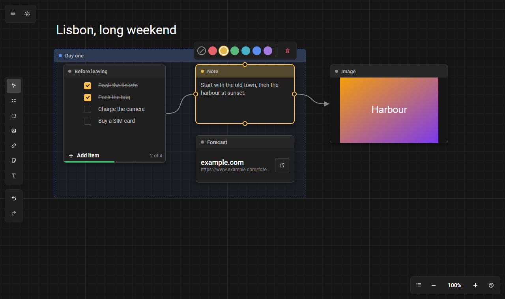
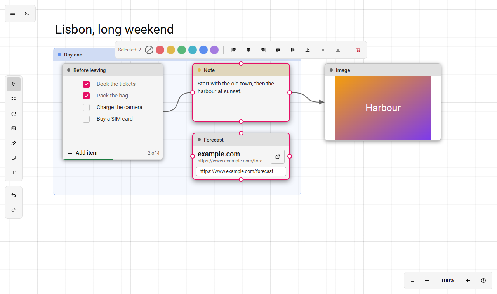

# workspace

<p align="center">
  
  
</p>

[English](README.md) · **Русский**

Рабочее пространство на нодах: заметки, текст, чеклисты, ссылки и картинки на бесконечном холсте, которые можно группировать и соединять линиями или стрелками. Типов данных у пинов нет: связи чисто визуальные. Всё работает в браузере, ничего никуда не отправляется.

**Стек:** Vue 3 + TypeScript + Vite + Pinia, интерфейс на [TaoUI](https://www.npmjs.com/package/@1337exp/taoui), поведение (камера, холст, история, команды, хранилище) из [TaoUX](https://www.npmjs.com/package/@1337exp/taoux). Тесты: Vitest + happy-dom.

```bash
npm install
npm run dev         # dev-сервер
npm run build       # проверка типов и сборка
npm test            # тесты
npm run typecheck
npm run screenshot  # docs/media/*.png для README, нужен Chrome или Edge
```

## Что умеет

**Ноды.** Добавляются инструментом в панели слева: нажми инструмент (или клавишу) и кликни по холсту, нода встанет центром в точку клика, `Esc` отменяет. Правый клик по пустому месту открывает меню, в нём «Добавить ноду…» открывает палитру.

| Нода | Клавиша | Что это |
|---|---|---|
| Заметка | `N` | рамка с полосой и текстом |
| Текст | `T` | текст прямо на холсте, без рамки; клик, сразу печатаешь; двойной клик правит; высота следует за содержимым, пустой текст исчезает; цвет из панели красит буквы |
| Чеклист | `L` | пункты с галочкой: `Enter` добавляет пункт ниже, `Backspace` в пустом убирает, `Tab` вкладывает пункт в предыдущий (до трёх уровней), `Shift+Tab` выносит, `Backspace` и `Enter` в пустом вложенном тоже выносят (мышью две кнопки справа появляются при наведении на пункт, пальцем у пункта в фокусе); у родителя `Enter` даёт первый подпункт; отметка родителя это отметка всех его подпунктов (при части выполненных чёрточка), счётчик считает пункты без подпунктов; стрелка слева от галочки сворачивает подпункты родителя (они остаются на месте и в счёте, у нового пункта после свёрнутого родителя глубина родителя), `↑` `↓` ходят по пунктам, за ручку слева пункт перетаскивается вместе с подпунктами (и с клавиатуры: на ручке `Пробел` поднимает, стрелки двигают, `Пробел` ставит, `Esc` отменяет), вставка многострочного текста раскладывается по пунктам (отступы дают вложенность, понимаются `-`, `*`, `•` и `[ ]` / `[x]`); внизу счётчик и полоса выполнения; «Скрыть выполненные» в панели над нодой |
| Ссылка | `K` | карточка: крупно имя узла, мелко адрес, кнопка открывает в новой вкладке; `example.com` дополняется до `https://example.com`; открываются только `http` и `https`; страницу мы не запрашиваем (ни заголовка, ни значка), чтобы не отправлять адреса сторонним сервисам |
| Картинка | `I` | картинка по ссылке |
| Группа | `G` | рамка под остальными: ноды целиком внутри неё едут вместе с ней, если тянуть за её полосу |

Название в полосе (у заметки, группы, чеклиста, ссылки) правится двойным кликом.

**Холст.**

| Действие | Как |
|---|---|
| Двигать камеру | правая или средняя кнопка мыши, колесо мыши или двухпальцевая прокрутка тачпада; `Shift` + колесо по горизонтали. Над нодой, которую можно прокрутить, колесо листает её |
| Масштаб | `Ctrl` (или `Cmd`) + колесо, щипок на тачпаде (точка под курсором остаётся на месте); кнопки «−» и «+», `=` / `-`, `Shift+0` (100%), `Shift+1` (показать всё) |
| Автопрокрутка | пока тянешь ноду, рамку, связь или край, подведи курсор к краю холста (48 px): камера поедет, чем ближе к краю, тем быстрее |
| Выделить | клик (нода поднимается над остальными, группы остаются подложкой); `Ctrl` / `Shift` + клик добавляет или снимает; рамка: тянуть левой кнопкой по пустому месту |
| Двигать ноду | за полоску с названием (поле ввода внутри ноды не тащит) или за сам текст у ноды «Текст» |
| Изменить размер | за любую грань или угол ноды (центр грани занят пином, берись рядом) |
| Привязка к сетке | пункт «Сетка» в меню вида (включена по умолчанию): нода мягко липнет к линиям сетки (шаг 24), между ними двигается свободно; растягивание и новые ноды тоже привязываются. `Alt` при перетаскивании отключает её на время |
| Направляющие | пункт «Направляющие» в меню вида (включены по умолчанию): пока тянешь ноды, их края и центр сравниваются с краями и центрами остальных нод; при совпадении (или ближе 6 px на экране) нода притягивается, и через совпавшее проходит тонкая линия; направляющая главнее сетки на своей оси. `Alt` отключает и их на время. Работают при перетаскивании; при изменении размера только сетка |

**Связи.**

| Действие | Как |
|---|---|
| Связать | потянуть от пина (их четыре: слева, справа, сверху, снизу) к другой ноде; если отпустить над телом ноды, возьмётся ближайшая сторона |
| Создать ноду из связи | отпустить протянутую связь над пустым местом |
| Точка на связи | двойной клик по связи ставит точку: её двигают за центр, от кольца вокруг неё тянут новые связи; `Delete` растворяет точку, соседи соединяются напрямую |
| Подпись | выбрать связь и нажать `F2` (или кнопку «Подпись» в панели, или пункт меню, или двойной клик по самой подписи): поле появляется на середине линии; `Enter` или клик в сторону сохраняет, `Esc` отменяет, пустая подпись убирается. Подпись выбирается кликом, как связь; до 120 знаков; при дублировании и копировании едет со связью; точка на связи оставляет её на первой половине |
| Вид связи | выбрать связь и переключить «Линия / Стрелка»; «Развернуть» меняет направление; «Выпрямить» сдвигает ноду, чтобы связь стала прямой |

**Панели.**

- **Слева:** «Выбор», по инструменту на каждый тип ноды, отмена и повтор.
- **Над выделением** (на сенсоре и узком экране закреплена внизу): цвет (6 цветов и «без цвета»; красит рамку и полосу, у группы ещё и заливку, у текста буквы), свойства типа ноды (у чеклиста «Скрыть выполненные», у текста «Крупный текст»), выравнивание по краям и центрам, распределение с равными промежутками (от трёх нод), у связи вид, «Развернуть» и «Выпрямить», «Удалить». Действует на все выделенные.
- **Внизу справа:** масштаб, меню вида («Показать всё», 100%, сетка) и справка «?» со списком жестов и клавиш.
- **Вверху слева:** меню ☰ (файл: «Новое», «Открыть» `Ctrl+O`, «Сохранить» `Ctrl+S`; тема светлая или тёмная; язык) и быстрый переключатель темы.

**Контекстное меню** (правый клик по ноде, связи или пустому месту): у ноды «Копировать» `Ctrl+C`, «Вырезать» `Ctrl+X`, «Дублировать» `Ctrl+D` (с вложенным в группу и связями между копиями, копии выделяются), «На передний план» `]`, «На задний план» `[`, переключатели типа ноды, цвет, выравнивание (от двух нод), «Удалить»; у связи вид, «Развернуть», «Выпрямить»; у пустого места «Вставить» `Ctrl+V` (вставляемое встаёт центром в точку клика), «Выбрать всё» `Ctrl+A`, «Добавить ноду…» (палитра), «Показать всё». Нода вне выделения при правом клике становится выделением, нода внутри выделения оставляет его, и меню действует на всё выделенное. Правая кнопка, которой водили, как и раньше двигает холст.

**Буфер обмена.** `Ctrl+C`, `Ctrl+X`, `Ctrl+V` и пункты меню работают через системный буфер: ноды лежат в нём обычным текстом в формате `workspace.json` (вместе с вложенным в группы и связями между скопированными), поэтому вставка работает между вкладками и окнами. Без выделенных нод и в полях ввода клавиши делают то, что делали. Вставка принимает и чужой текст: адрес `http(s)` становится нодой «Ссылка», остальной текст (до 10 000 знаков) нодой «Текст». Повторная вставка того же сдвигается на 24 px, чтобы копии не слипались; если вставляемое не в видимой области, оно ложится в центр экрана. Если браузер не даёт доступ к буферу (пункты меню без клавиш), показывается сообщение.

Остальные клавиши: `Delete` удаляет выбранное, `Ctrl+Z` / `Ctrl+Y` отменяют и повторяют, `Esc` снимает инструмент, затем палитру, затем выделение. Буквенные клавиши работают и на русской раскладке.

**Сенсор (планшет).** Палец двигает холст, два пальца двигают и масштабируют, долгое нажатие на пустом месте открывает палитру, а на ноде или связи контекстное меню, двойной тап работает как двойной клик, режим «Выделение» в панели слева заменяет `Ctrl`. Перо считается мышью. Подробности и чек-лист проверки: [docs/touch.md](docs/touch.md) (на русском). `?debug=touch` в адресе показывает распознанные жесты.

**Сохранение.** Пространство сохраняется автоматически в `localStorage`; «Сохранить» и «Открыть» работают с файлом `workspace.json`. Тема и привязка к сетке запоминаются в браузере и в файл не попадают.

Интерфейс на русском и английском, светлая и тёмная тема.

## Как добавить свою ноду

Нода делится на **определение** (код, живёт в реестре) и **экземпляр** (данные, лежат в сохранении).
Создай папку `src/nodes/<имя>/` с `index.ts` и Vue-компонентом: больше ничего регистрировать не нужно, а инструмент в панели слева, клавиша и справка появятся сами.

```ts
// src/nodes/note/index.ts
export default defineNode({
    id: 'note',
    title: 'Note',                                   // запасное название; переводы в i18n/locales/*.ts → nodeTexts
    icon: 'node-note',                               // имя иконки, см. src/icons.ts
    hotkey: 'N',                                     // клавиша инструмента
    size: { w: 240, h: 160, minW: 120, minH: 80 },
    create: () => ({ text: '' }),                    // данные новой ноды
    component: NoteNode,                             // props: data, selected; событие change(patch)
});
```

Остальное в определении необязательно:

- `titleKey` — поле данных с названием в полосе (правится двойным кликом);
- `container` — нода-группа: лежит под остальными, увозит вложенные;
- `bare` — без рамки и полосы (текст);
- `inlineEdit` и `isEmpty` — правка на месте и удаление пустой ноды после неё; компонент получает `editing` и сообщает `edit-end` и `fit` (нужную высоту);
- `actions` — переключатели типа ноды в панели над выделением (`get` / `set` по данным; подпись в словаре `nodes.<тип>.action.<id>`);
- `version` и `migrate(data, from)` — данные ноды это пользовательский контент: поменял формат, подними версию, старые сохранения приедут сами.

Нода с неизвестным типом не ломает загрузку: рисуется заглушкой, а её данные сохраняются как есть.

## Как устроено

```
src/
  core/     чистая модель без Vue: типы, реестр, операции над пространством, границы, выравнивание, сохранение и чтение
  nodes/    определения нод (note, text, checklist, link, image, group, reroute)
  editor/   интерфейс редактора
  i18n/     переводы (ru, en)
  icons.ts  наши иконки рядом со встроенными tao-* из TaoUI
tests/      модель, стор, команды, нода «Чеклист» и «Ссылка», положение панели
scripts/    скриншоты для README
```

В `src/editor/`:

- `store.ts` — тонкий стор: собирает срезы из `state/` (`selection`, `view`, `prefs`, `drag`, `connect`, `edit`, `place`, `tool`), каждый про своё, и подключает сессию документа (история, автосохранение, файлы);
- `commands.ts` — реестр команд (подпись, сочетание клавиш, «можно ли сейчас», действие): кнопки, панели и горячие клавиши только вызывают его, поэтому не расходятся;
- `canvasHost.ts` — мост между холстом (`taoux/canvas`) и стором;
- `components/` — `ToolDock`, `ZoomBar`, `AppMenu`, `ContextBar` (положение считает `floating.ts`), холст, ноды, палитра.

Оформление: шрифт Roboto в `src/assets/font`, свои цвета из токенов `--tao-color-*`, цвета нод в `src/styles/colors.css`. Мост `@1337exp/taoux/taoui.css` наводит переменные модулей TaoUX на тему TaoUI, поэтому холст и связи следуют светлой и тёмной теме.

## Пока нет

Умные направляющие при перетаскивании, рисование, стикеры и комментарии. Копирование картинок и файлов, вставка картинок из буфера. Сенсорное управление проверено только в эмуляции, не на настоящем планшете. Подробнее: [PLAN.md](PLAN.md).

## Лицензия

[MIT](LICENSE)

## Мы

Домашняя страница: [666.io](https://666.io). Хочешь помочь, предложить идею или просто поговорить — заходи.
